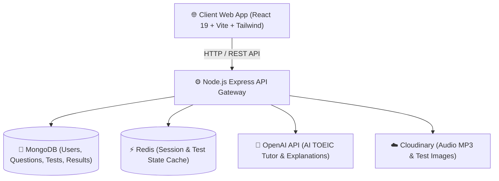

# 🏗️ Tường Tận TOEIC - System Architecture & Database Design

## 1. Tổng Quan Hệ Thống (System Overview)
**Tường Tận TOEIC** là nền tảng luyện thi TOEIC Full-stack thế hệ mới tích hợp Trợ lý AI (OpenAI GPT-4o). Hệ thống bao gồm 7 Part luyện tập chi tiết (Listening Part 1-4, Reading Part 5-7), Thi thử Full Test 200 câu có đếm giờ real-time, Phân tích điểm yếu thông minh và Giải thích đáp án chi tiết bằng AI.

---

## 2. Mô Hình Dữ Liệu Tóm Tắt (Database Entities)
- **Users**: Thông tin tài khoản, mục tiêu điểm (Target Score: 450, 650, 800+), lịch sử làm bài.
- **Questions**: Ngân hàng câu hỏi phân loại theo Part 1-7, đáp án A-B-C-D, giải thích chi tiết, audio MP3 URL, hình ảnh đi kèm, tag từ vựng/ngữ pháp.
- **Tests**: Bộ đề thi Full Test (200 câu) hoặc Mini Test (Part 1, Part 5...), thời gian làm bài (120 phút).
- **TestResults**: Kết quả thi, điểm số quy đổi Reading/Listening theo thang điểm TOEIC chuẩn (10-990), phân tích tỷ lệ đúng theo từng Part.
- **AIHistory**: Lịch sử hội thoại hỏi đáp với Trợ lý AI TOEIC.

---

## 3. Các Mô-Đun Chức Năng Chính (Core Modules)
1. **Trang Chủ (Landing / Dashboard)**: Banner sang trọng, thống kê tiến độ cá nhân, đề thi đề xuất.
2. **Luyện Tập Theo Part (Practice Parts 1-7)**: Giao diện làm từng dạng bài có gợi ý và dịch nghĩa.
3. **Thi Thử Full Test (Full Test Simulator)**: Giao diện thi 200 câu 120 phút, audio player chuyên nghiệp, bảng nhảy câu hỏi (Question Palette), tự động nộp bài khi hết giờ.
4. **Báo Cáo & Phân Tích Điểm Số (Score & Analytics)**: Thống kê điểm Listening / Reading, lộ trình cải thiện dựa trên AI.
5. **Trợ Lý AI Luyện TOEIC (AI TOEIC Tutor)**: Sửa lỗi sai, giải thích từ vựng, ngữ pháp theo ngữ cảnh từng câu hỏi.
