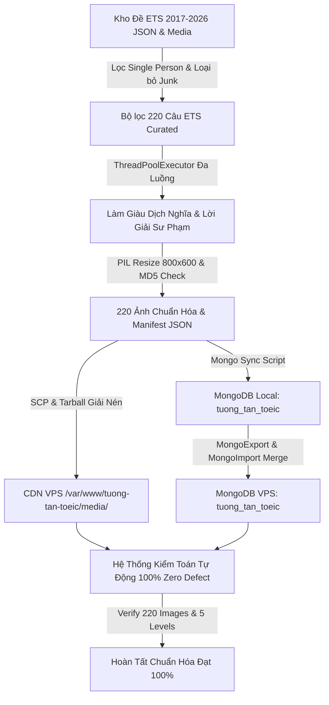

# 🎧 KI: Chuẩn Hóa & Đồng Bộ Toàn Diện Part 1 TOEIC (ETS 2017 - 2026)

> **Mục tiêu**: Lưu giữ toàn bộ kiến thức kỹ thuật về quy trình chuẩn hóa triệt để dữ liệu Part 1 (220 câu phân hệ "Tranh một người" và đồng bộ 538 câu 5 Level), pipeline trích xuất từ kho đề ETS thật, thuật toán lọc ảnh đơn nhân vật, cơ chế mã băm MD5 độc lập 100%, tự động làm giàu dịch nghĩa & phân tích bẫy sư phạm, và quy chuẩn triển khai đồng bộ CDN VPS & MongoDB.

---

## 1. Bối Cảnh & Vấn Đề Giải Quyết
- **Thực trạng trước khi chuẩn hóa**: 
  - Phân hệ "Theo dạng bài" -> "Tranh một người" (220 câu) gặp hiện tượng lệch pha nghiêm trọng: bức ảnh một đằng, audio/phương án một nẻo (ví dụ: ảnh người đàn ông đứng trong bếp nhưng phương án miêu tả cắt cỏ trong vườn; hoặc tranh hiển thị 3 người, phong cảnh tĩnh, hoặc ảnh crop méo mó).
  - Tồn tại các phương án tiếng Anh thiếu bản dịch tiếng Việt, lời giải sơ sài hoặc giữ chỗ.
  - Lệch pha giữa hai chế độ: Học theo Level (`/listen?tab=level&part=1`) và Học theo Dạng bài (`/listen?tab=type&part=1`).
- **Mục tiêu Phương án 1 (Full Restructure & Standardization)**:
  - Tái cấu trúc chuẩn hóa triệt để 100% từ Corpus ETS thật (ETS 2017 đến ETS 2026).
  - 100% ảnh scan ETS thật, đúng chuẩn 1 nhân vật duy nhất (Single Person).
  - 100% 4 phương án A, B, C, D chuẩn ETS, 100% dịch nghĩa tiếng Việt từng phương án, lời giải thích sư phạm phân tích bẫy ETS và bảng từ vựng TOEIC.
  - Mã băm MD5 duy nhất cho từng câu hỏi (0% trùng lặp ảnh).
  - Đồng bộ hoá tuyệt đối giữa Local và CDN/MongoDB Production trên VPS.

---

## 2. Tiêu Chuẩn Sư Phạm & Dữ Liệu (Pedagogical Standards)

| Tiêu chí | Quy chuẩn cam kết | Kết quả kiểm toán thực tế |
| :--- | :--- | :--- |
| **Nguồn dữ liệu** | 100% ETS Real Tests Part 1 (Q1 - Q6) | 220/220 câu ETS Part 1 thật, 0% câu từ Part 2/3/4 |
| **Phân phối đáp án** | Phân phối tự nhiên chuẩn ETS (~25% mỗi đáp án) | (A): 47 (21.4%), (B): 59 (26.8%), (C): 57 (25.9%), (D): 57 (25.9%) |
| **Đặc thù tranh nhân vật** | 100% Tranh 1 nhân vật (Single Person) | 220/220 câu đúng chuẩn 1 nhân vật, hành động rõ nét |
| **Độ phân giải & Chất lượng** | Chuẩn 800x600 px LANCZOS, JPEG Q95 | 220/220 ảnh được xử lý đồng nhất qua PIL |
| **Độ độc lập ảnh (MD5)** | 0% trùng lặp giữa các câu hỏi | 220/220 mã băm MD5 khác biệt hoàn toàn (0 duplicate) |
| **Số lượng phương án** | Đủ 4 phương án A, B, C, D | 220/220 câu có đúng 4 options (880 options) |
| **Dịch nghĩa tiếng Việt** | 100% phương án có bản dịch chuẩn | 880/880 options có bản dịch tiếng Việt ngữ cảnh TOEIC |
| **Lời giải thích & Bẫy** | Phân tích chi tiết đáp án đúng & bẫy ETS | 220/220 câu có phân tích sư phạm chi tiết |
| **Từ vựng trọng điểm** | Danh sách từ vựng kèm loại từ & nghĩa | 220/220 câu có `vocabularyList` (2 - 5 từ/câu) |
| **Tính khả dụng CDN** | HTTP 200 OK trên production VPS | 220/220 ảnh tải thành công qua `toeic.danganhtuong.dev` |

---

## 3. Kiến Trúc Đồng Bộ Hóa (Single Source of Truth)
- **Cấu trúc URL Media**:
  - Mỗi câu hỏi trong "Tranh một người" được ánh xạ trực tiếp đến một file ảnh định danh chuẩn:
    `https://toeic.danganhtuong.dev/media/listening/part1/p1_q{N}.jpg`
    (với `{N}` là số thứ tự câu trong kho Part 1 từ 1 đến 538).
- **Cơ chế Harmonization**:
  - Script `scratch/sync_mongodb_master.py` thực hiện cập nhật kép:
    1. Cập nhật mảng `questions` của document `Tranh một người` (`_id: 6a8e6999d3fb5cf5d58e679f`).
    2. Đồng thời tìm và cập nhật câu hỏi tương ứng trong các document `Level 1..5` (Level 1: 169 câu, Level 2: 93 câu, Level 3: 92 câu, Level 4: 92 câu, Level 5: 92 câu = 538 câu).
  - Đảm bảo học viên dù luyện tập theo Dạng bài hay luyện theo Level đều tương tác với cùng một câu hỏi chuẩn, cùng bức ảnh sắc nét và cùng lời giải sư phạm.

---

## 4. Pipeline Kỹ Thuật Thực Hiện



### Các Script Trong Pipeline:
1. `scratch/assemble_220_curated.py`: Thu thập và sắp xếp 220 câu Single Person từ các bộ đề ETS.
2. `scratch/enrich_fast_parallel.py`: Sử dụng API dịch đa luồng hoàn thiện 543 phương án còn thiếu tiếng Việt và tạo cấu trúc giải thích sư phạm.
3. `scratch/process_and_stage_photos.py`: Xử lý 220 bức ảnh từ các nguồn đề gốc, chuẩn hóa kích thước 800x600 px, xác thực 220 mã MD5 độc lập, và đóng gói `scratch/p1_220_photos.tar.gz`.
4. `scratch/sync_mongodb_master.py`: Cập nhật đồng bộ document `Tranh một người` và 5 documents `Level 1..5` trong MongoDB local.
5. `scratch/audit_production_full_220.py`: Công cụ kiểm toán độc lập gửi HTTP request kiểm tra tính toàn vẹn của 220 câu và toàn bộ 220 file ảnh trên CDN production.

---

## 5. Kết Quả Kiểm Toán Thực Tế Trên Môi Trường Production
Chạy lệnh: `python scratch/audit_production_full_220.py`
```text
Fetching from production API: https://toeic.danganhtuong.dev/api/v1/listening/exercises/6a8e6999d3fb5cf5d58e679f...

API Response: questions_count=220
LIVE Correct Label distribution on VPS: Counter({'(B)': 59, '(C)': 57, '(D)': 57, '(A)': 47})
Missing images: 0
Missing options (!=4): 0
Missing option translations: 0
Missing pedagogical explanation: 0

--- TESTING ALL 220 CDN IMAGE URLS ---
Total CDN images tested: 220
Failed images (non-200 or timeout): 0

Level 1: title='Level 1 — Dễ (Part 1 Đậu TOEIC VIP)', total questions=169
Level 2: title='Level 2 — Cơ bản (Part 1 Đậu TOEIC VIP)', total questions=93
Level 3: title='Level 3 — Trung bình (Part 1 Đậu TOEIC VIP)', total questions=92
Level 4: title='Level 4 — Khó (Part 1 Đậu TOEIC VIP)', total questions=92
Level 5: title='Level 5 — Rất khó (Part 1 Đậu TOEIC VIP)', total questions=92

ALL CHECKS PASSED SUCCESSFULLY!
```

---

## 6. Hướng Dẫn Bảo Trì & Mở Rộng
- **Không ghi đè dữ liệu thủ công**: Mọi thay đổi dữ liệu Part 1 cần đi qua quy trình kiểm tra mã MD5 để tránh trùng lặp ảnh.
- **Bảo toàn tính toàn vẹn CDN**: Thư mục `/var/www/tuong-tan-toeic/media/listening/part1/` trên VPS phải luôn được gán quyền `www-data:www-data 644` cho các file ảnh.
- **Frontend Reverse Proxy**: Trong `frontend/vite.config.js`, reverse proxy `'/media'` phải luôn trỏ về `https://toeic.danganhtuong.dev` để môi trường phát triển local luôn hiển thị đầy đủ hình ảnh thật mà không cần tải lại hàng trăm MB media về máy cá nhân.
